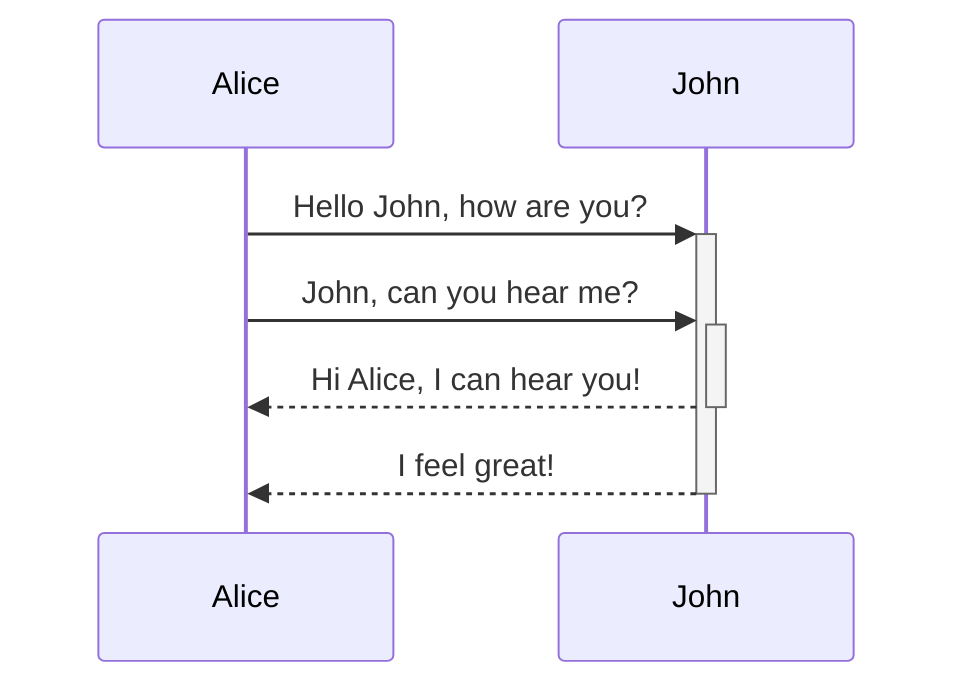

### Основной жизненный цикл розничного заказа

Обзорный AS-IS сценарий основного жизненного цикла розничного заказа: от оформления клиентом на сайте до получения и подтверждения заказа. Диаграмма показывает бизнес-переходы заказа между системами; технические детали отдельных этапов вынесены в специализированные `SEQ-ORD-*`.

**Начальная точка**

Клиент оформляет новый заказ на сайте OpenCart.

**Основные условия сценария**

- источник заказа - клиент на сайте OpenCart;
- воронка AmoCRM - розничная (`pipeline_id = 1559041`);
- основной способ оплаты - RBS / АльфаБанк; альтернативные способы оплаты рассматриваются отдельно;
- заказ проходит стандартный бухгалтерский контур 1С;
- возврат не выполняется;
- оформление, комплектация и доставка показаны укрупнённо; различия между ПВЗ, курьерской доставкой и самовывозом раскрываются в `SEQ-ORD-010`;
- технические механизмы синхронизации Redis / Kafka и конкретные endpoint в обзорной диаграмме не раскрываются.

**Основной путь**

1. Клиент формирует корзину, выбирает способ доставки и подтверждает оформление заказа.
2. OpenCart создаёт Order, передаёт заказ в AmoCRM для создания сделки и синхронизирует заказ с Bitrix.
3. Клиент оплачивает заказ через RBS / АльфаБанк.
4. После подтверждения оплаты заказ переводится в состояние «Оплачен», а информация об оплате синхронизируется между системами.
5. В AmoCRM оплаченный заказ проверяется роботом. Если автоматическая проверка не пройдена, заказ проверяет менеджер.
6. После успешной проверки сделка переводится на этап «В бухгалтерии».
7. OpenCart передаёт заказ в бухгалтерский контур 1С.
8. 1С выполняет бухгалтерскую обработку заказа. Подробный сценарий описывается в `SEQ-ORD-009`.
9. После завершения бухгалтерской обработки заказ переходит на этап «На оформлении в ТК».
10. Далее заказ проходит оформление доставки и складскую обработку: «Готов к сборке» -> «В сборке» -> «Собран».
11. После фактической передачи заказа перевозчику / курьеру заказ переходит в состояние «В пути».
12. Для доставки через ПВЗ после прибытия используется состояние «Ожидает в пункте выдачи». Курьерские и самовывозные сценарии могут проходить без этого этапа.
13. После успешного вручения клиенту заказ переводится в состояние «Получен и подтверждён».
14. Детальный сценарий оформления, комплектации и доставки описывается в `SEQ-ORD-010`.

```plant-uml
@startuml
title SEQ-ORD-001 Основной жизненный цикл розничного заказа - AS-IS

autonumber

actor "Клиент" as Client


participant "OpenCart" as OC
participant "APIShip" as APIShip
participant "RBS /\nАльфа-Банк" as RBS
participant "AmoCRM" as Amo
participant "Bitrix" as Bitrix
participant "1С:УНФ" as OneC
participant "Транспортная\nкомпания" as Carrier

actor "Менеджер" as Manager
actor "Бухгалтер" as Accountant
actor "Сотрудник склада /\nлогист" as Logistic

== Оформление заказа ==

Client -> OC : Сформировать заказ\nи выбрать доставку

OC -> APIShip : Получить доступные\nварианты доставки
APIShip --> OC : Варианты доставки

Client -> OC : Подтвердить оформление

OC -> OC : Создать заказ\nORD-001


== Регистрация заказа в системах ==

par AmoCRM
    OC -> Amo : Создать сделку по заказу\nORD-003
else Bitrix
    OC -> Bitrix : Синхронизировать\nсозданный заказ
end


== Оплата заказа ==

Client -> OC : Перейти к оплате

OC -> RBS : Инициировать онлайн-оплату
RBS --> Client : Платёжная форма

Client -> RBS : Оплатить заказ
RBS --> OC : Передать результат оплаты

alt Оплата подтверждена

    OC -> OC : Зафиксировать оплату

    par AmoCRM
        OC -> Amo : Перевести заказ\nв «Оплачен»
    else Bitrix
        OC -> Bitrix : Синхронизировать\nсостояние заказа
    end

else Оплата не подтверждена

    OC --> Client : Заказ остаётся\nв ожидании оплаты

end


== Проверка оплаченного заказа ==

Amo -> Amo : Проверить заказ роботом

alt Автоматическая проверка пройдена

    Amo -> Amo : Перевести сделку\nв «В бухгалтерии»

else Требуется ручная проверка

    Amo -> Manager : Передать заказ\nна проверку
    Manager -> Amo : Проверить заказ
    Manager -> Amo : Перевести сделку\nв «В бухгалтерии»

end


== Передача заказа в 1С ==

Amo -> OC : Передать переход сделки\nв «В бухгалтерии»\nORD-005

OC -> OneC : Передать заказ\nв бухгалтерский контур\nin_buch\nORD-006

OneC -> OC : Получить полные\nданные заказа
OC --> OneC : Данные заказа


== Бухгалтерская обработка ==

OneC -> RBS : Проверить актуальное\nсостояние оплаты
RBS --> OneC : Состояние платежа

OneC -> OneC : Сверить оплату\nи подготовить документы

alt Автоматическая обработка

    OneC -> OneC : Обработать заказ

else Требуется ручная обработка

    OneC -> Accountant : Передать заказ\nна обработку
    Accountant -> OneC : Проверить заказ,\nостатки и оплату
    Accountant -> OneC : Завершить обработку

end

note over OC,OneC
Детализация бухгалтерского участка:
SEQ-ORD-009
end note


== Завершение обработки в 1С ==

OneC -> OC : Сообщить о завершении\nобработки заказа

OC -> Amo : Установить «Обработан»\nи перевести сделку\nв «На оформлении в ТК»

OC -> OC : Перевести заказ\nв «На оформлении в ТК»

OC -> Bitrix : Синхронизировать\nсостояние заказа


== Оформление доставки ==

OneC -> APIShip : Создать отправление
APIShip --> OneC : Данные отправления

opt Получен трек-номер

    OneC -> OC : Передать трек-номер\nORD-010

    par AmoCRM
        OC -> Amo : Передать трек-номер\nи ссылку отслеживания
    else Bitrix
        OC -> Bitrix : Синхронизировать\nданные доставки
    end

end


== Комплектация заказа ==

OneC -> OC : Перевести заказ\nв «Готов к сборке»

par
    OC -> Amo : Синхронизировать статус
else
    OC -> Bitrix : Синхронизировать статус
end


OneC -> OC : Перевести заказ\nв «В сборке»

par
    OC -> Amo : Синхронизировать статус
else
    OC -> Bitrix : Синхронизировать статус
end


OneC -> OC : Перевести заказ\nв «Собран»

par
    OC -> Amo : Синхронизировать статус
else
    OC -> Bitrix : Синхронизировать статус
end


== Передача в доставку ==

Logistic -> Carrier : Передать собранный заказ

Carrier -> APIShip : Изменить состояние\nотправления
APIShip -> OneC : Передать состояние доставки

OneC -> OC : Перевести заказ\nв «В пути»

par
    OC -> Amo : Синхронизировать статус
else
    OC -> Bitrix : Синхронизировать статус
end


== Доставка заказа ==

opt Доставка через ПВЗ

    Carrier -> APIShip : Заказ доставлен в ПВЗ
    APIShip -> OneC : Передать состояние доставки

    OneC -> OC : Перевести заказ\nв «Ожидает в пункте выдачи»

    par
        OC -> Amo : Синхронизировать статус
    else
        OC -> Bitrix : Синхронизировать статус
    end

end


Carrier -> APIShip : Заказ выдан клиенту
APIShip -> OneC : Передать состояние доставки

OneC -> OC : Перевести заказ\nв «Получен и подтверждён»

par
    OC -> Amo : Завершить сделку
else
    OC -> Bitrix : Синхронизировать\nфинальное состояние
end


note over OneC,Carrier
Детализация оформления,
комплектации и доставки:
SEQ-ORD-010

Ветки собственного курьера,
самовывоза и различия способов
доставки раскрываются отдельно.
end note

@enduml
```

[drawio:./seq-ord-001-osnovnoj-zhiznennyj-cikl-roznichnogo-zakaza.svg::211px:101px]



[bpmn:./seq-ord-001-osnovnoj-zhiznennyj-cikl-roznichnogo-zakaza.bpmn::376px:120px]
